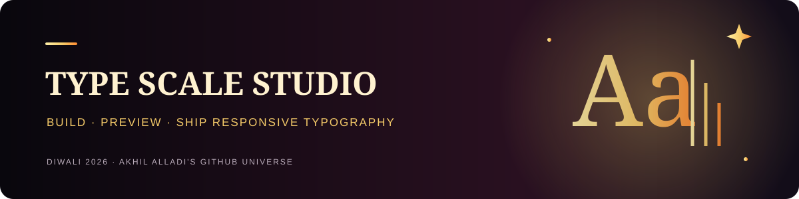

<p align="center"><a href="https://akhilalladi-code.github.io/diwali-universe/"><strong>🪔 Explore Diwali Universe 2026 · Interactive celebration ↗</strong></a></p>

# Type Scale Studio

A browser-based typography design workspace for building, previewing, managing and shipping responsive type systems.

## Workspaces
- **Scale Generator** — eight named scale ratios, custom ratio, base size, step count, viewport range and configurable fluid bounds.
- **Interactive Canvas** — live desktop/mobile editorial preview with 20 curated display/body font pairings, headline sizing, body line-height and measure controls.
- **Scale Comparison** — compare Minor Third, Major Third and Perfect Fourth with the same base size.
- **Token Manager** — edit scale values and inspect CSS/JSON token output.
- **Preset & Project Library** — curated presets, local custom presets, shareable URLs, project collection import and export.
- **Typography Guide** — educational guide to modular scales, fluid type, font pairing, semantic roles and accessibility.

## Export formats
CSS custom properties, fluid CSS using `clamp()`, JSON, Tailwind font-size configuration, SCSS variables and Tokens Studio-style JSON for Figma workflows. Validate exported token structures in your own design-tool version before production use.

## Privacy and storage
The app has no account or backend. Current configuration, token overrides and saved projects are stored in browser local storage. Share URLs include configuration values. Export your project collection to move saved presets to another browser.

## Accessibility and quality
Semantic page landmarks, form labels, live status messages, reduced-motion support, and Node test coverage for core scale generation, exports and page structure. The CI workflow runs `npm test` and JavaScript syntax checks before deployment.

## Run locally
```bash
npm test
npm run check
```
Open `index.html` in a modern browser. Google Fonts are loaded remotely when available; system fallbacks are provided.

## Project structure
```text
index.html
generator/ canvas/ compare/ tokens/ presets/ guide/
src/  core.js  studio.js  generator.js  canvas.js  compare.js  tokens.js  presets.js  site.css
tests/  core.test.js  site.test.js
```

## License
MIT. See [LICENSE](LICENSE).
